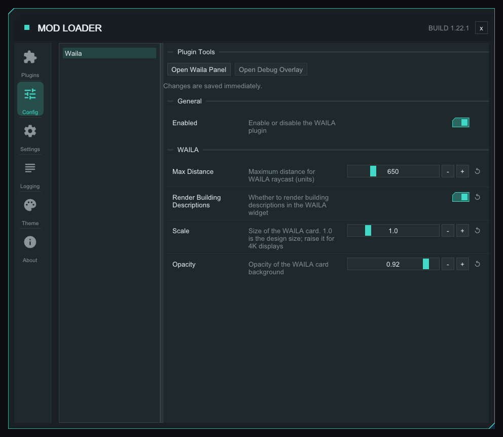

# StarRupture-Plugin-WAILA

**W**hat **A**m **I** **L**ooking **A**t? — a real-time HUD overlay plugin for the [StarRupture ModLoader](https://github.com/AlienXAXS) targeting the Chimera (UE5) game. Inspired by the classic Minecraft WAILA mod, it displays live information about factory buildings and machines directly in the game HUD as the player looks at them.

## Features

- Raycast-based detection — identifies the building the player's crosshair is aimed at
- Per-building info panels rendered via ImGui, including:
  - **Crafters** — current recipe, crafting progress, speed multiplier, missing items / output-full flags, and what each ingredient needs per minute at the machine's speed, the product's items per minute, and, for an ingredient the machine is short of, a red "short N/min" worked out from what has been arriving over the last minute, and a "No power" header when the machine has no electricity
  - **Storage** — storage contents and capacity
  - **Power** — power consumption/production state
  - **Active Coolers** — cooling load and status
  - **Passive Coolers** — passive heat-sink info
  - **Cargo Senders** — send interval, send progress, current item being shipped
  - **Cargo Receivers** — incoming cargo state
  - **Drone Rails** — what the machines attached to a rail's network make and take, read from the game's drone logistics, so it works with nothing moving and along the whole line, out of render range too. See [Rail card](#rail-card) <sup>[✦](#msantoro12)</sup>
- Configurable max detection distance, card scale/opacity, and optional building descriptions
- Thread-safe: game tick and ImGui render thread are fully decoupled via mutex

## Rail card <sup>[✦](#msantoro12)</sup>

Aim at a drone rail and the card shows what travels along it, item by item. WAILA follows the rails back from the one you point at, through poles, junctions, mergers, storage and stations, to the machines feeding it, then on from the rail's end to every machine taking the items. Drones riding a rail do not get in the way: the aim looks through them to the rail behind.

**Header.** The rail's name and what it carries per minute ("Rail v.3  480/min"), then a dot and "From 20 to 4": how many buildings make the items on it and how many take them (a building counts for each item it makes or takes). The dot is:
- **green** when all is good: the machines asking for an item right now want no more than the rail can bring. For an item only storage supplies, or a Cargo Receiver not yet seen sending, which has no rate to compare, green means the storage holds some or the receiver brings it; a receiver with a measured rate counts like any maker;
- **orange** when they want more than the rail can bring (a bottleneck), or, for an item only storage supplies, when the storage holds none and a machine is asking for it. The item then gets an orange "Short N/min" line under its To line (what the machines asking for it right now want, less the most the rail can bring), and the machines on its To line are drawn in the same orange;
- **red** when a machine feeding the rail is starved, short of an input. That machine's name on the From line is drawn in red; a kind with both starved and running machines is split, so only the starved ones are red ("Furnace v.2" red, "2x Furnace v.2" plain);
- **grey** when there is nothing to judge, for example nothing takes from the rail.

**Each item** shows its icon and name, then a bulleted line each for:
- **From** and **To**: the buildings making and taking it, buildings of one kind together with their count, the biggest kind first ("From 2x Fabricator v.2, Furnace"; at most three kinds, then "+N more"). A long line continues on the next one. A machine filling a depot reads "From 4x Assembler via Storage Depot v.2", and machines taking from a depot are listed as takers. An item only a depot holds reads "From Storage Depot v.2". A Cargo Receiver is listed as a source ("From Cargo Receiver") and a Cargo Sender as a taker, each counted for what its connections put on the rail or take off it (see below);
- **Stored**: what the storage on the network holds of it ("Stored 18.6k in 3x Storage Depot v.2"), and "Stored 0 in Storage Depot v.2" when the storage on the line is empty of it;

and under them, in line with the text, **min · max · current** per minute. All three are about the makers feeding the rail. Max is what they make at full speed, capped at what the rail itself carries. Min is what they can make with the inputs they get now, the same capped: a starved maker counts 0, any other its full rate. Current is what is moving now: the smaller of what the makers are putting out right now (a stalled maker puts out nothing, capped at the rail) and what the machines asking for the item right now want. The machines taking an item never lower min or max; current runs anywhere from 0 to max. Cargo Receivers and Senders are counted at their own rate, which the game does not give, so WAILA measures it: the items in one package of a connection over the time between its sends, summed over the connections that put the item on this rail (a receiver) or take it off (a sender). Until a connection has been seen sending twice, the send interval stands in for the time between sends; one never seen sending reads "?" (a receiver's max and current then read the makers' part followed by "+?", or just "?" for an item only receivers bring). WAILA keeps measuring while you are not aiming at a rail, so a rate is ready by the time you do. A connection that has stopped sending counts 0 in current, and a receiver whose connections have all stopped counts 0 in min too and is drawn red on the From line like a starved maker.

**Using it.** Aim at a rail you suspect is a bottleneck. An orange dot says the takers want more than the rail brings: add a maker or a second rail. A red dot says a feeder is starved: follow the rail back to the makers in "From" and aim at one to see which ingredient it is short of. A "current" well under "max" means the takers ask for less than the rail can bring; a current at max with an orange "Short" line means the rail is full and the takers still want more.

A card shows up to twelve rows, and a long From, To or Stored row can take up to three lines. A rail with nothing linked reads "Nothing connected", and "Rail data not available" when WAILA cannot read the rail's network on this game build.

## Requirements

- Visual Studio 2022 (MSVC v143, C++20)
- [StarRupture-Game-SDK](https://github.com/AlienXAXS/StarRupture-Game-SDK)
- [StarRupture-Plugin-SDK](https://github.com/AlienXAXS/StarRupture-Plugin-SDK)
- StarRupture with ModLoader installed

## Building

Open `StarRupture-Plugin-Waila.sln` in Visual Studio 2022 and build, or use MSBuild from the repository root:

```bat
msbuild StarRupture-Plugin-Waila.sln /p:Configuration="Client Debug" /p:Platform=x64
```

Output is placed at `build/<Configuration>/Plugins/Waila.dll`.

### Configurations

| Configuration | Description |
|---|---|
| `Client Debug` | Client mod build with debug symbols |
| `Client Release` | Optimised client mod build |
| `Server Debug` | Server-side build with debug symbols |
| `Server Release` | Optimised server-side build |
| `Local SDK Client Debug/Release` | Client build using a local SDK checkout |
| `Local SDK Server Debug/Release` | Server build using a local SDK checkout |

SDK checkout paths can be adjusted in [`Shared.props`](Shared.props) to match your local directory layout.

## Installation

1. Build the DLL (see above).
2. Copy `Waila.dll` into the game's `Plugins/` directory alongside the other StarRupture mod DLLs.
3. Launch the game — the ModLoader will load the plugin automatically.

On first run, `Waila.ini` is generated in `<game_dir>/Plugins/config/` with default values.

## Configuration

`Waila.ini` is auto-created on first run. Edit it in game on the mod loader's config page (F2):



Available options:

| Section | Key | Default | Description |
|---|---|---|---|
| `General` | `Enabled` | `true` | Enable or disable the plugin entirely |
| `WAILA` | `Max Distance` | `650.0` | Maximum raycast range for HUD display in Unreal units (0 – 2500), counted from the player or the building drone |
| `WAILA` | `Render Building Descriptions` | `true` | Show/hide the building description line in the HUD panel |
| `WAILA` | `Scale` | `1.0` | Size of the card, 0.5 to 3.0; raise it for 4K displays |
| `WAILA` | `Opacity` | `0.92` | Opacity of the card background, 0.3 to 1.0 |

## Architecture

```
Engine tick → WailaUIManager::Tick()
  → WailaRaycastSystem::PerformRaycast()   [Core/raycaster.h]
  → *Detector::Is*(actor)                   [detector classes]
  → *Detector::Get*Info(actor, info)
  → mutex-locked update of pending info structs
  → ImGui render callback reads info and draws HUD panel
```

### Key Files

| File | Role |
|---|---|
| [`plugin.cpp`](Waila/plugin.cpp) | `GetPluginInfo` / `PluginInit` / `PluginShutdown` C exports |
| [`UI/ui_manager.h`](Waila/UI/ui_manager.h) | Singleton owning tick, ImGui widget, and thread-safe info structs |
| [`Core/raycaster.h`](Waila/Core/raycaster.h) | Line trace from the player's camera, so it follows the building drone too; returns `RaycastHit` |
| [`crafter_detector.h`](Waila/crafter_detector.h) | Detects and reads `ACrCrafter` actors |
| [`storage_detector.h`](Waila/storage_detector.h) | Detects and reads storage buildings |
| [`power_detector.h`](Waila/power_detector.h) | Detects and reads power buildings |
| [`cooler_active_detector.h`](Waila/cooler_active_detector.h) | Detects active cooler machines |
| [`cooler_passive_detector.h`](Waila/cooler_passive_detector.h) | Detects passive cooler machines |
| [`cargo_sender_detector.h`](Waila/cargo_sender_detector.h) | Detects cargo sender machines |
| [`cargo_receiver_detector.h`](Waila/cargo_receiver_detector.h) | Detects cargo receiver machines |
| [`rail_detector.h`](Waila/rail_detector.h) | Detects drone rails and sums, per item, the crafters that feed them and the machines after them that take from them |
| [`waila_functions.h`](Waila/waila_functions.h) | Pattern-scanned function pointers for internal game APIs |
| [`plugin_config.h`](Waila/plugin_config.h) | Schema-based `Waila.ini` config with typed accessors |

### Adding a New Detector

1. Create `<type>_detector.h` / `<type>_detector.cpp` implementing:
   ```cpp
   static bool Is<Type>(SDK::AActor* actor);
   static bool Get<Type>Info(SDK::AActor* actor, <Type>Info& out);
   ```
2. Add a `m_pending<Type>Info` field (guarded by `m_infoMutex`) in `WailaUIManager`.
3. Call the detector in `WailaUIManager::Tick()`.
4. Add a `Render<Type>Info()` branch in the ImGui render callback.

## License

This project is provided as-is for modding purposes. See the StarRupture ModLoader documentation for distribution terms.

## Credits

Original mod by [@AlienXAXS](https://github.com/AlienXAXS)

- <a id="msantoro12"></a><sup>✦</sup> [@msantoro12](https://github.com/msantoro12) (maintainer), creator of [StarRupture Planner](https://starrupture.goodstuff.software)
- The way the cargo connections are read from the package transport replicator follows [MapExtension_Plugin](https://github.com/Mralexandresys/MapExtension_Plugin) by Mralexandresys (MIT, Copyright (c) 2026 MapExtension_Plugin contributors)
